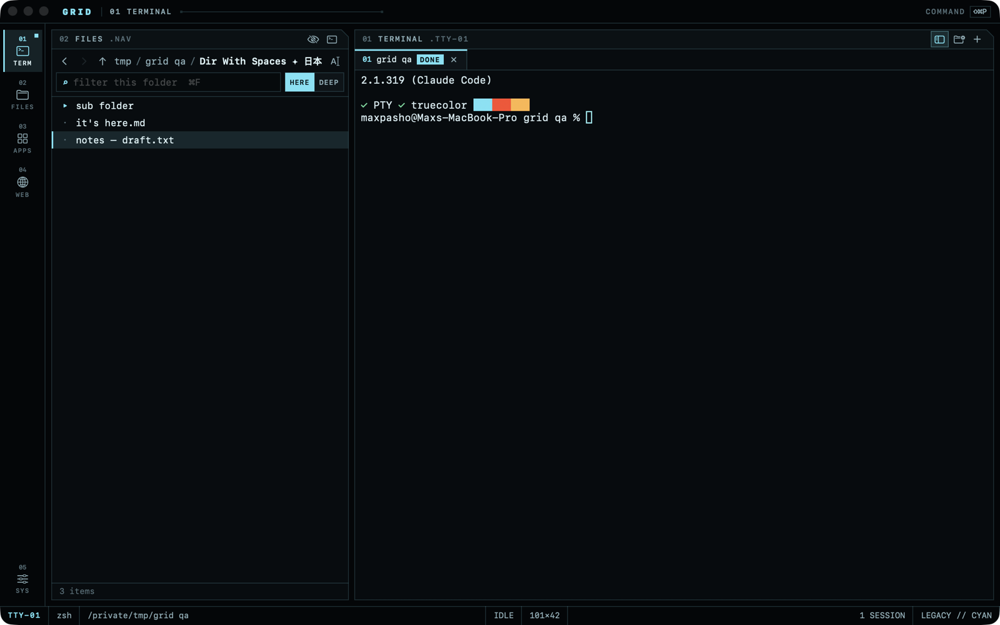

# GRID

A terminal-first macOS workspace: a real PTY terminal, a file browser, and an app launcher in one
keyboard-driven window, with a restrained interface language derived from the *Tron: Legacy* and
*Tron: Ares* production design. Native Swift (SwiftUI + AppKit) on top of
[SwiftTerm](https://github.com/migueldeicaza/SwiftTerm).



- **docs/ARCHITECTURE.md**: proposal, stack comparison, architecture, security model, web research
- **docs/DESIGN.md**: visual spec and design tokens
- **docs/PLAN.md**: staged checklist (what's done, what's next)
- **docs/TESTING.md**: test results and manual checklist
- **LICENSES.md**: dependencies and licenses

## Requirements
macOS 14+, Xcode 16+ (developed with Xcode 27.2 / Swift 6.4). No other tools.

## Build & run
```bash
scripts/bundle.sh          # release build -> build/GRID.app
open build/GRID.app
```
Development:
```bash
swift build                # compile
swift test                 # unit tests
scripts/bundle.sh debug    # debug .app with QA hooks (see docs/TESTING.md)
open Package.swift         # work in Xcode (run the "Grid" scheme)
```
Running the bare executable from `swift run` works for quick checks, but use the `.app` bundle for
real use: macOS privacy prompts, the Dock icon, and LaunchServices need a bundle identifier.

## Packaging for distribution
GRID can't be App-Sandboxed (its shell must reach your files), so it ships outside the Mac App Store:
```bash
SIGN_ID="Developer ID Application: Your Name (TEAMID)" scripts/bundle.sh
ditto -c -k --keepParent build/GRID.app build/GRID.zip
xcrun notarytool submit build/GRID.zip --keychain-profile <profile> --wait
xcrun stapler staple build/GRID.app
```
Include SwiftTerm's MIT license notice with binaries (see LICENSES.md).

## First run: what to expect
- The first time a shell or the file browser touches **Desktop, Documents, Downloads**, or a
  removable/network volume, macOS asks “GRID would like to access…”. That's the normal privacy
  system; GRID never tries to get around it. Until you answer, that command waits.
- Your login shell (zsh by default) starts as a login shell, so your PATH and dotfiles load as they
  do in Terminal.app.

## Keyboard
| Keys | Action |
|---|---|
| ⇧⌘P | Command palette (configurable: ⌘K, ⇧⌘Space) |
| ⌘T / ⌘W | New / close terminal session |
| ⌘1…⌘9, ⇧⌘[ ⇧⌘] | Select / cycle sessions |
| ⌥⌘1…⌥⌘4, ⌘, | Terminal · Files · Apps · Web · Settings |
| ⌘B / ⌘I | Files sidebar / inspector |
| ⌥⌘T | New session in the current Files folder |
| ⇧⌘J | Show the terminal's directory in Files |
| ⌘L, ⌘F, ⌘[ ⌘] ⌘↑, ⇧⌘. | Files: path · filter · back/forward/up · hidden files |
| ⌘K | Clear scrollback (unless used for the palette) |

Palette grammar (application commands, never sent to the shell): `app Safari`,
`files ~/Projects`, `term ~/Projects`, `web example.com`, `theme ares`.

## Implemented (Milestone 1)
Real PTY terminal with tabs, busy and finished-job indicators, safe quit and close, kernel-based
working-directory tracking, and safe drag-to-insert paths. File browser with breadcrumbs, editable
path, history, sorting, filter vs recursive search, inspector with preview, live refresh, and clear
permission and missing-item states. App launcher with search, pins, recents, and moved-app recovery.
Command palette. Three themes (Legacy cyan, Ares red, ENCOM amber). Independently toggleable glow,
motion, and backdrop effects, with Reduce Motion respected. Web: opening addresses in the default
browser.

## Known limitations
- No split panes or file operations (create, rename, move, trash) yet: Milestone 2.
- Directory tracking follows the shell process only (not ssh or subshell `cd`); Files follows only
  when asked.
- App discovery scans standard folders (≤3 levels); apps elsewhere don't appear (Spotlight-based
  discovery is a possible addition).
- Closing the window via the red button quits GRID; busy sessions then get a native alert instead of
  the in-app confirmation.
- Web pages aren't rendered in-app yet (Milestone 3: reader mode first).
- No app icon yet.

## Privacy
No telemetry, accounts, network services, or AI integration. Settings are stored in UserDefaults
(`local.grid.workspace`). Terminal contents and browsing are never logged or persisted.
