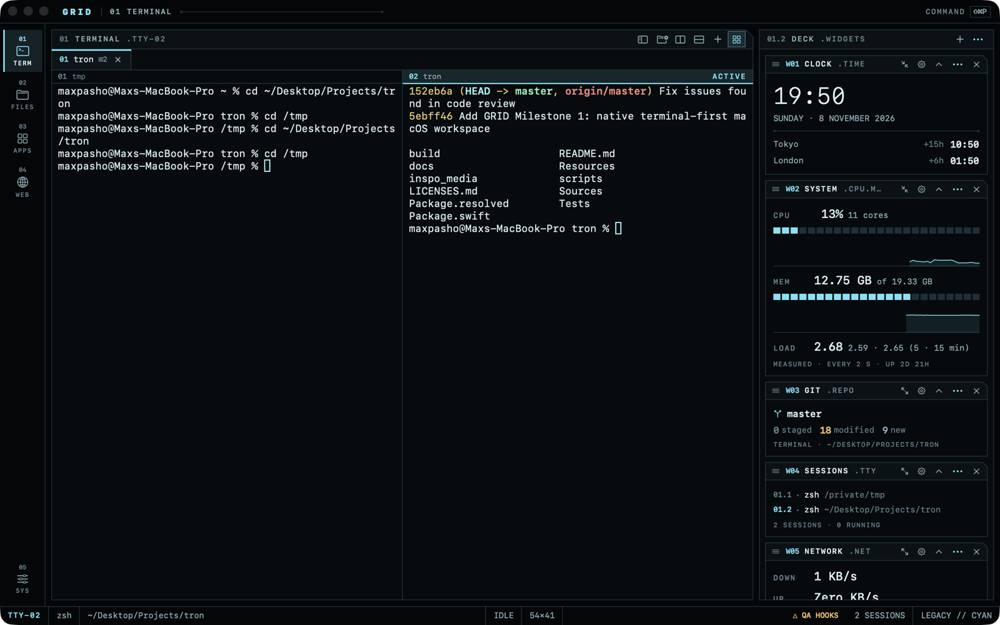

# GRID

A terminal-first macOS workspace: a real PTY terminal, a file browser, and an app launcher in one
keyboard-driven window, with a restrained interface language derived from the *Tron: Legacy* and
*Tron: Ares* production design. Native Swift (SwiftUI + AppKit) on top of
[SwiftTerm](https://github.com/migueldeicaza/SwiftTerm).



- **docs/ARCHITECTURE.md**: proposal, stack comparison, architecture, security model, web research
- **docs/DESIGN.md**: visual spec and design tokens
- **docs/PLAN.md**: staged checklist (what's done, what's next)
- **docs/TESTING.md**: test results and manual checklist
- **LICENSES.md**: dependencies and licenses

## Requirements
macOS 14+, Xcode 16+ (developed with Xcode 27.2 / Swift 6.4). No other tools.

## Build & run
```bash
scripts/bundle.sh          # release build -> build/GRID.app
open build/GRID.app
```
Development:
```bash
swift build                # compile
swift test                 # unit tests
scripts/bundle.sh debug    # debug .app; QA hooks only with `--args --qa` (see docs/TESTING.md)
open Package.swift         # work in Xcode (run the "Grid" scheme)
```
Running the bare executable from `swift run` works for quick checks, but use the `.app` bundle for
real use: macOS privacy prompts, the Dock icon, and LaunchServices need a bundle identifier.

## Packaging for distribution
GRID can't be App-Sandboxed (its shell must reach your files), so it ships outside the Mac App Store:
```bash
SIGN_ID="Developer ID Application: Your Name (TEAMID)" scripts/bundle.sh
ditto -c -k --keepParent build/GRID.app build/GRID.zip
xcrun notarytool submit build/GRID.zip --keychain-profile <profile> --wait
xcrun stapler staple build/GRID.app
```
Include SwiftTerm's MIT license notice with binaries (see LICENSES.md).

## First run: what to expect
- The first time a shell or the file browser touches **Desktop, Documents, Downloads**, or a
  removable/network volume, macOS asks “GRID would like to access…”. That's the normal privacy
  system; GRID never tries to get around it. Until you answer, that command waits.
- Your login shell (zsh by default) starts as a login shell, so your PATH and dotfiles load as they
  do in Terminal.app.

## Keyboard
| Keys | Action |
|---|---|
| ⇧⌘P | Command palette (configurable: ⌘K, ⇧⌘Space) |
| ⌘T / ⌘W / ⇧⌘W | New tab / close pane (or tab) / close tab (⌘W on other panels returns to the terminal) |
| ⌘D / ⇧⌘D, ⌥⌘← ⌥⌘→ | Split the focused pane right / down (mix freely), move between panes; drag dividers to resize |
| ⌘F, ⌘G / ⇧⌘G | Find in the terminal (case / regex / whole word), next / previous match |
| ⌘1…⌘9, ⇧⌘[ ⇧⌘] | Select / cycle tabs (double-click a tab to rename it) |
| ⌘B / ⌥⌘0 / ⌘J | Files / Terminal / Widget Deck panels (show or hide) |
| ⌥⌘1…⌥⌘4, ⌘, | Terminal · Files · Apps · Web · Settings |
| ⌘B / ⌘I | Files sidebar / inspector |
| ⌥⌘T | New session in the current Files folder |
| ⇧⌘J | Show the terminal's directory in Files |
| ⌘L, ⌘F, ⌘[ ⌘] ⌘↑, ⇧⌘. | Files: path · filter · back/forward/up · hidden files |
| ⇧⌘N, ⌘C ⌘V ⌥⌘V, ⌘⌫, ⌘Z | Files: new folder · copy/paste/move · Move to Trash · undo |
| Space, ⇧↑↓, ⌘A, ⌘-click ⇧-click | Files: Quick Look · multi-select |
| ▸ click, → / ←, ⌥→ | Files: expand / collapse folders in place (⌥ expands 3 levels) |
| ⌘K | Clear scrollback |

Every shortcut except ⌘1–⌘9 can be changed in **Settings › Keyboard**: click a shortcut and press
the new keys. Shortcuts must include ⌘ (or be F1–F12) so they never take keys from programs in the
terminal, and conflicts and reserved combinations are refused.

Palette grammar (application commands, never sent to the shell): `app Safari`,
`files ~/Projects`, `term ~/Projects`, `web example.com`, `theme ares`.

## Implemented

**Workspace docking:** Files, Terminal and the Widget Deck are dockable panels.
- **Move:** drag a panel's title bar (≡) onto another panel's left, right, top or bottom edge; a highlight shows where it will land.
- **Close and reopen:** × closes a panel, and closing the terminal panel only hides it, so sessions keep running. Reopen panels from the View menu, their shortcuts, or the buttons shown when everything is closed.
- **Resize:** drag the dividers.
- **Persists:** the layout is saved across launches; *View › Reset Workspace Layout* restores the default.

**Terminal panes** move the same way. Drag a pane's header onto another pane's edge, onto a tab (to move it into that tab), or onto empty tab-bar space (to give it its own tab). Drag tabs to reorder them. Each pane header has its own ×.

**Milestone 2:** split panes (up to 4 per tab), tab rename, bell indicator. File operations:
new folder, inline rename, duplicate, copy/cut/paste and move, drag into Files, Move to Trash,
Delete Immediately (confirmed), name-conflict handling (Replace / Keep Both / Skip), and multi-step
undo. Multi-select, Quick Look (Space), Open With, multi-path drag into the terminal. Draggable
panel dividers and persisted layout (widths, visibility, last folder). App icon. WCAG-AA label
contrast. Cached file listing.

**Widget deck (⌘J):** eleven built-in widgets that show real data or perform real actions, plus
your own:
- **Clock:** extra time zones.
- **System:** CPU, memory, load and uptime, measured.
- **Network:** live rates and IP.
- **Storage** and **Power:** disk space; battery charge and charging state.
- **Sessions:** your tabs and panes; click to switch.
- **Pinned Apps:** a launch strip.
- **Git:** status of the terminal's folder or a fixed repo.
- **Notes** and **Recent Files.**
- **File Inspector:** the Files selection before you drag it into the terminal: the exact quoted
  text it will insert, executable/interpreter and "downloaded from" warnings, line count,
  encoding, line endings, image size, a preview, folder totals on request, and Insert / Copy /
  Quick Look / Terminal actions. Drag its icon into the terminal to insert the path.
- **Custom widgets:** folders with a `manifest.json` and JavaScript. **New Widget…** scaffolds one
  that hot-reloads as you edit; **Install…** reviews and copies someone else's. They run in a
  sandboxed helper process, can only use what you approve (shown in plain words with exact
  commands, paths and hosts), and are drawn with GRID's own components. See
  [docs/WIDGETS.md](docs/WIDGETS.md) and [widgets/examples](widgets/examples).

Drag a card by its title bar onto another card's edge, like docking a panel: left or right puts it
beside that card, top or bottom gives it its own row. Rows show their cards side by side (handy
with the deck docked at the bottom) and wrap when the deck is too narrow. The deck's ⋯ menu has
**Place All Side by Side** and **Stack All Vertically**, and each card's ⋯ menu moves it up, down,
left or right. ⚙ flips a card to its settings, ↗ expands it, ⌃ collapses it, × removes it, and +
opens the gallery. The layout persists.

**Milestone 1:**
Real PTY terminal with tabs, busy and finished-job indicators, safe quit and close, kernel-based
working-directory tracking, and safe drag-to-insert paths. File browser with breadcrumbs, editable
path, history, sorting, filter vs recursive search, inspector with preview, live refresh, and clear
permission and missing-item states. App launcher with search, pins, recents, and moved-app recovery.
Command palette. Three themes (Legacy cyan, Ares red, ENCOM amber). Independently toggleable glow,
motion, and backdrop effects, with Reduce Motion respected. Web: opening addresses in the default
browser.

## Known limitations
- A tab holds up to 6 panes.
- Multi-item drags into Finder carry only the first item (an AppKit/SwiftUI drag limitation);
  drags into GRID's terminal carry them all.
- The Git widget runs `git status` in the terminal's folder (with `core.fsmonitor` disabled). Like
  any shell prompt that shows git status, a malicious repo's filter config could still run
  commands, so point it only at repos you trust (or give it a fixed path).
- Directory tracking follows the shell process only (not ssh or subshell `cd`); Files follows only
  when asked.
- App discovery scans standard folders (≤3 levels); apps elsewhere don't appear (Spotlight-based
  discovery is a possible addition).
- Closing the window via the red button quits GRID; busy sessions then get a native alert instead of
  the in-app confirmation. (⌘W never closes the window while sessions exist: it closes the
  active session, or returns to the terminal from other panels.)
- Web pages aren't rendered in-app yet (Milestone 3: reader mode first).
- ⌘1–⌘9 (tab switching) and ⌘Z in the file list aren't rebindable.

## Privacy
No telemetry, accounts, network services, or AI integration. Settings are stored in UserDefaults
(`local.grid.workspace`). Terminal contents and browsing are never logged or persisted.
